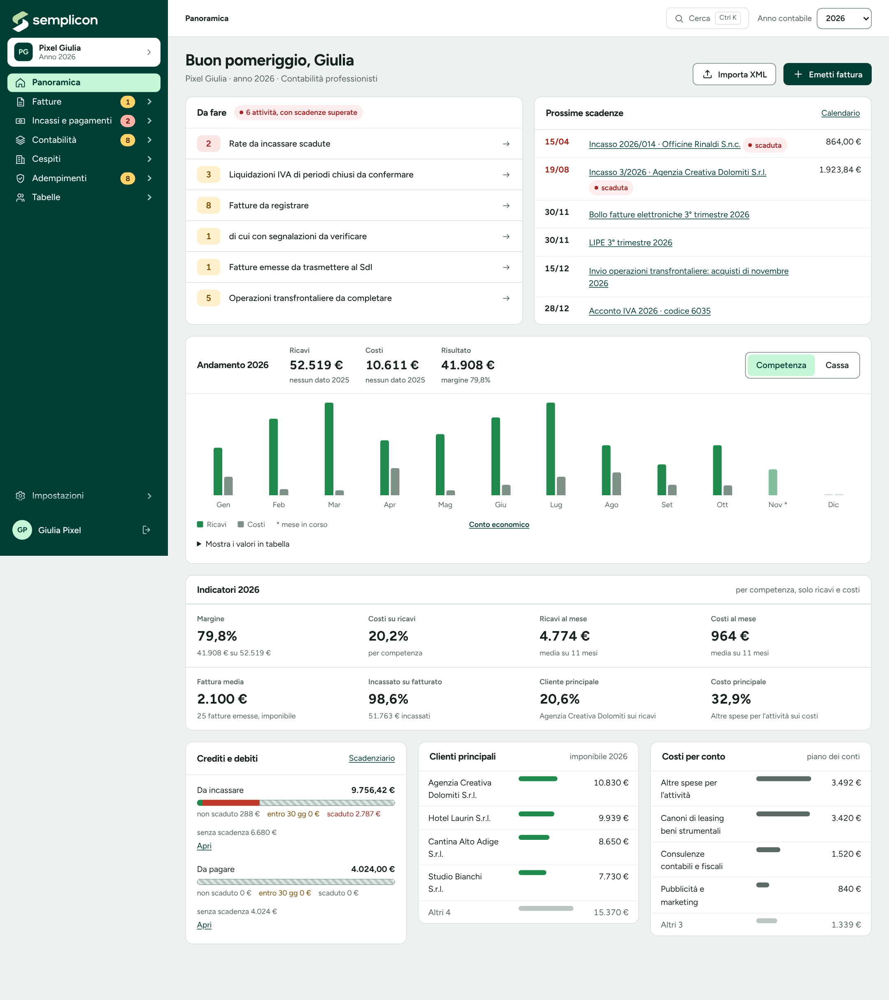
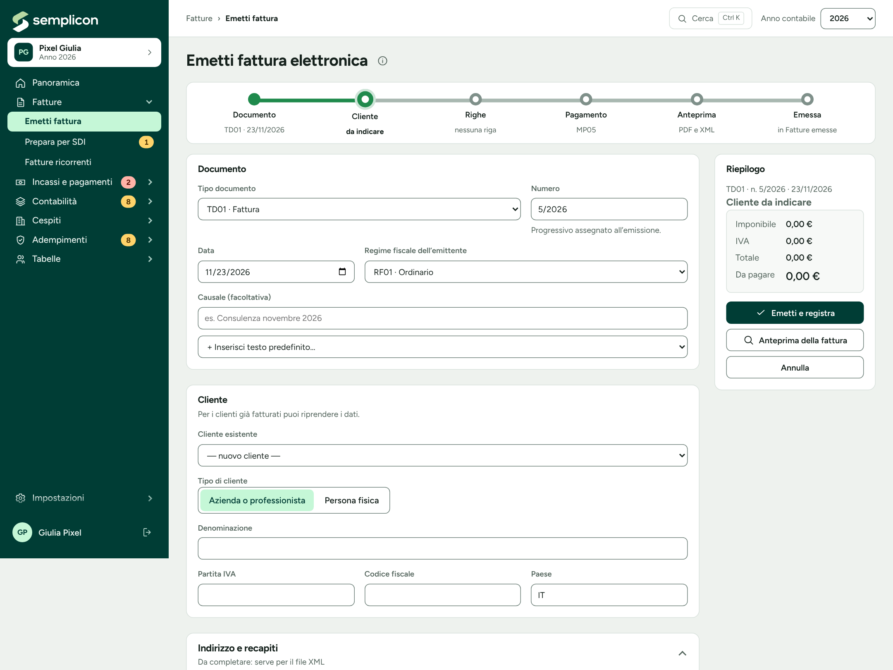
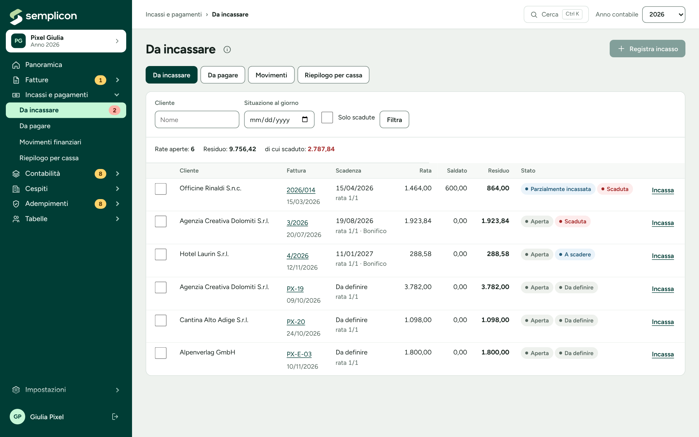
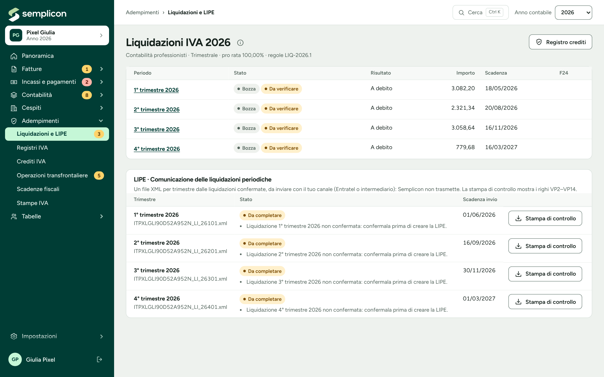
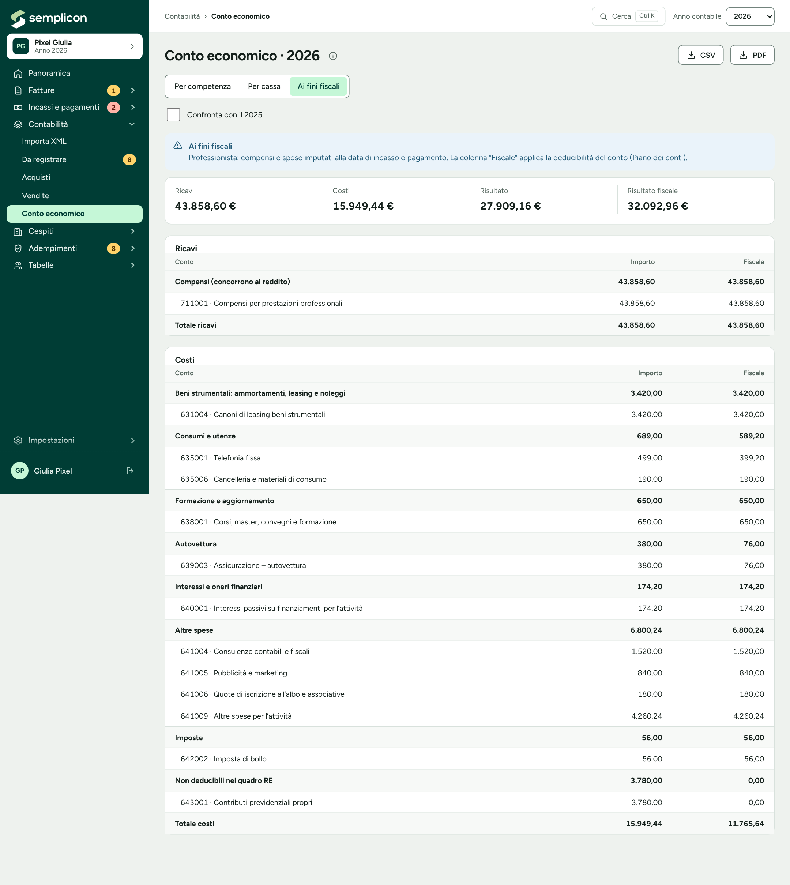
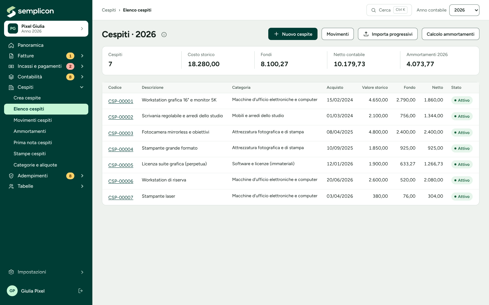
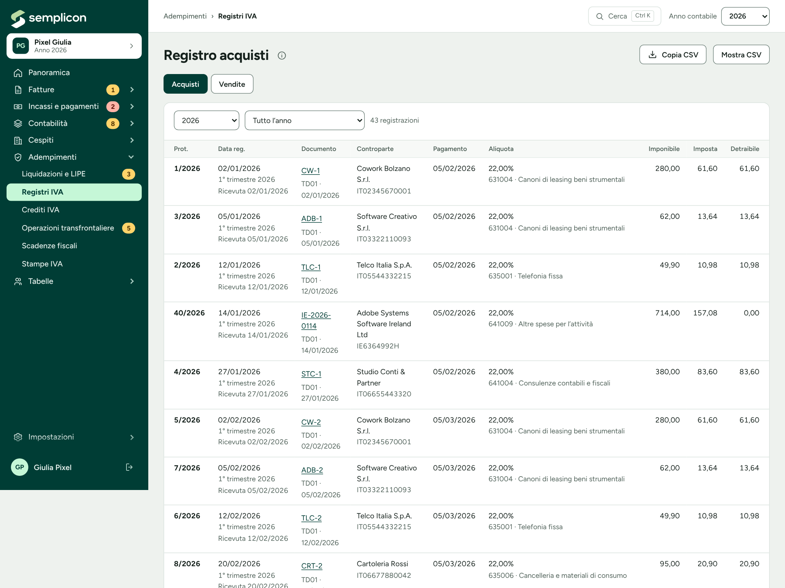

<picture>
  <source media="(prefers-color-scheme: dark)" srcset="design/logo/semplicon_logo_fondo_scuro.svg">
  
</picture>

# La contabilità semplice, open source.

Un’applicazione web per la contabilità italiana, pensata per professionisti e piccole imprese in contabilità semplificata. Da installare sul proprio server, con codice aperto e un’interfaccia in italiano.

[Sito ufficiale](https://semplicon.it/) · [Apri la demo online](https://semplicon.it/demo/)

[Perché Semplicon](#perché-semplicon) · [Funzionalità](#funzionalità) · [Schermate](#schermate) · [Provalo](#prova-semplicon) · [Domande frequenti](#domande-frequenti) · [Contribuisci](#contribuisci)

> [!WARNING]
> **Versione beta, attualmente in fase di test.** Funzioni, calcoli e flussi sono in evoluzione. La validazione professionale delle regole fiscali è ancora aperta: Semplicon non è approvato per l’uso in produzione o per adempimenti reali. Provalo con dati di esempio e consulta i [limiti della beta](docs/BETA.md).

*Schermata della demo con l’azienda di esempio «Pixel Giulia». I dati sono dimostrativi.*

## Perché Semplicon

**Capire i propri numeri dovrebbe essere semplice.** Semplicon nasce per riunire i passaggi della contabilità quotidiana: importare una fattura, verificarla, registrarla, seguirne il pagamento e ritrovarla nei prospetti.

- **Un percorso dal documento al riepilogo.** Fatture, registrazioni, incassi, pagamenti e IVA sono collegati nello stesso ambiente.
- **Le attività da fare, subito visibili.** La panoramica evidenzia documenti da registrare, rate aperte e prossime scadenze.
- **Pensato per il contesto italiano.** FatturaPA, registri IVA, piano dei conti, codici ATECO e gestione dei cespiti.
- **Sul tuo server.** L’applicazione può essere installata su un’infrastruttura gestita da te. Hosting, manutenzione e backup restano a carico di chi la gestisce.
- **Aperto al contributo di tutti.** Codice consultabile, problemi discutibili e miglioramenti condivisibili.

### A chi si rivolge

A professionisti e piccole imprese in **contabilità semplificata**, anche nel passaggio dal regime forfettario a una gestione con IVA, e a chi vuole contribuire allo sviluppo di strumenti contabili aperti per l’Italia.

L’applicazione distingue «Contabilità professionisti» e «Contabilità semplificata», con configurazione del regime per azienda e anno. Il perimetro dei casi gestiti e le eccezioni sono descritti nei [limiti della beta](docs/BETA.md). Non è un gestionale completo per la contabilità ordinaria.

## Funzionalità

Questi moduli sono presenti nella versione in sviluppo. **La disponibilità tecnica non equivale alla validazione fiscale.** La demo HTML riproduce i flussi con alcune semplificazioni.

| Area | Cosa puoi esplorare nella beta |
|---|---|
| **Panoramica** | Attività da completare, scadenze, andamento di ricavi e costi, crediti e debiti, indicatori dell’attività. |
| **Fatture elettroniche** | Compilazione delle fatture, ritenuta e cassa previdenziale, numerazione, note di credito, ricorrenze ed esportazione XML FatturaPA. L’invio allo SdI avviene tramite un canale esterno. |
| **Importazione** | Import XML, ZIP e P7M nell’applicazione web, controlli sui documenti, rilevamento dei duplicati, confronto dei conflitti e archivio degli originali. |
| **Registrazione** | Verifica guidata, scelta del conto, detraibilità IVA, allegati, fatture manuali, storni e movimenti fuori campo IVA. |
| **Incassi e pagamenti** | Rate, partite aperte, movimenti finanziari, attribuzione dei pagamenti e riepilogo fiscale per cassa. |
| **IVA** | Registri acquisti e vendite, liquidazioni periodiche, registro crediti, prospetti F24 in bozza e generazione LIPE da validare. |
| **Operazioni con l’estero** | Integrazioni IVA e reverse charge, documenti TD16–TD19 e gestione delle operazioni transfrontaliere. |
| **Conto economico** | Lettura per competenza, per cassa e ai fini fiscali, con confronto tra esercizi. |
| **Cespiti** | Anagrafica beni, categorie, movimenti, ammortamenti civilistici e fiscali, prima nota e stampe. |
| **Anagrafiche e tabelle** | Clienti, fornitori, catalogo di articoli e testi, piano dei conti, regole di contabilizzazione, ATECO e parametri fiscali. |
| **Archivio e stampe** | Esportazioni CSV/PDF, archivio annuale con impronte SHA-256, strumenti di backup e ripristino. L’archivio non sostituisce la conservazione a norma. |
| **Aziende e interfaccia** | Più aziende per utente, configurazione per anno, ruolo amministratore, ricerca rapida e interfaccia adattabile allo smartphone. |

[Esplora le funzionalità →](docs/FUNZIONALITA.md)

## Schermate

Le immagini provengono dalla **demo HTML**, con dati di esempio. Mostrano l’interfaccia e non attestano la correttezza fiscale dei risultati.

<table>
<tr>
<td width="50%"> <b>Fatture elettroniche</b> · Dati, righe, ritenuta e cassa.</td>
<td width="50%"> <b>Incassi e pagamenti</b> · Le partite aperte a colpo d’occhio.</td>
</tr>
<tr>
<td width="50%"> <b>Liquidazioni IVA</b> · Periodi e riepiloghi da verificare.</td>
<td width="50%"> <b>Conto economico</b> · Ricavi, costi e risultato.</td>
</tr>
<tr>
<td width="50%"> <b>Cespiti</b> · Beni e valori nello stesso ambiente.</td>
<td width="50%"> <b>Registri IVA</b> · Dal riepilogo al documento.</td>
</tr>
</table>

[Guarda tutte le 51 schermate, incluse le viste per smartphone →](docs/SCHERMATE.md)

## Prova Semplicon

[Apri la demo nel browser](https://semplicon.it/demo/) per provare Semplicon con i dati di esempio.

### Apri la demo in locale

1. Scarica il repository con **Code → Download ZIP** ed estrailo.
2. Apri [`demo/semplicon-demo.html`](demo/semplicon-demo.html) nel browser.
3. Scegli l’utente demo Jana ed esplora l’azienda «Pixel Jana».

Non occorre avviare un server. La demo usa dati nel browser e simula alcune funzioni; non invia documenti allo SdI. Usa soltanto dati fittizi. [Percorso guidato e differenze rispetto all’applicazione →](docs/PRIMI_PASSI.md)

### Installa l’applicazione in locale

Per provare il backend Laravel e l’archiviazione su database, segui la [guida di installazione](docs/INSTALLAZIONE.md).

**Stack:** Laravel 13 · PHP 8.3+ · Vue 3 · TypeScript · Inertia · Vite · PostgreSQL. SQLite è disponibile per le prove locali. Per compilare l’interfaccia serve Node.js 20.19+ oppure 22.12+ nelle linee compatibili indicate dal lockfile.

## Stato del progetto

**Beta · in fase di test.** Il lavoro si concentra sulla verifica dei flussi contabili, sulla validazione fiscale e sul consolidamento dell’applicazione.

- **Disponibile per le prove:** codice dell’applicazione, demo HTML, dati sintetici, suite di test e documentazione tecnica.
- **Da completare o verificare:** validazione fiscale, verifica LIPE rispetto allo schema ufficiale, ulteriori verifiche operative e di sicurezza.
- **Non disponibile:** invio diretto allo SdI; reset della password, verifica dell’e-mail e autenticazione a due fattori risultano ancora da implementare nella documentazione di stato.

Consulta [Beta e limiti](docs/BETA.md), [stato tecnico](docs/STATUS.md) e [piano di sviluppo](docs/PLAN.md). I risultati dei test riportati nei documenti tecnici si riferiscono alle esecuzioni lì indicate.

## Domande frequenti

<b>Posso usarlo subito per la mia contabilità reale?</b>

Non ancora: la versione attuale è destinata alle prove. La validazione fiscale è aperta e non è approvata per adempimenti reali.

<b>Semplicon invia le fatture al Sistema di Interscambio?</b>

No. Genera i file XML; l’invio deve essere eseguito con un programma o un canale esterno. Segnare una fattura come trasmessa nell’interfaccia non effettua l’invio.

<b>È gratuito e open source?</b>

Il codice è distribuito con licenza AGPL-3.0-only. L’installazione su un proprio server comporta eventuali costi di infrastruttura, gestione e servizi esterni. Consulta il testo della [licenza](LICENSE).

<b>Posso gestire più aziende?</b>

Sì, un utente può gestire più aziende. L’amministratore accede a tutte le aziende dell’installazione. L’accesso condiviso di più persone alla stessa azienda non è attualmente previsto.

<b>L’archivio è un servizio di conservazione a norma?</b>

No. L’archiviazione dei documenti, le impronte SHA-256 e i backup sono strumenti tecnici; non costituiscono un servizio di conservazione a norma.

<b>La demo è uguale all’applicazione completa?</b>

La demo permette di esplorare molti degli stessi flussi, ma mantiene i dati nel browser e semplifica alcune funzioni. Per esempio, VIES è simulato, il modulo cespiti è semplificato e il backup riguarda i dati della demo. Per verificare il backend occorre installare l’applicazione.

## Documentazione

| Per iniziare | Per approfondire |
|---|---|
| [Primi passi](docs/PRIMI_PASSI.md) | [Funzionalità](docs/FUNZIONALITA.md) |
| [Installazione locale](docs/INSTALLAZIONE.md) | [Beta e limiti](docs/BETA.md) |
| [Galleria delle schermate](docs/SCHERMATE.md) | [Stato tecnico](docs/STATUS.md) |
| [Come contribuire](CONTRIBUTING.md) | [Regole fiscali da validare](docs/FISCAL_RULES.md) |

[Indice completo della documentazione →](docs/README.md)

## Contribuisci

Semplicon cerca contributi da sviluppatori, professionisti della contabilità e persone disponibili a provare i flussi e segnalare ciò che non funziona o non è chiaro.

Puoi [segnalare un problema](https://github.com/arassele/semplicon/issues), proporre un miglioramento, migliorare i testi o contribuire con codice e casi di test. Non pubblicare dati fiscali reali, fatture di clienti o credenziali nelle segnalazioni.

Leggi [come contribuire](CONTRIBUTING.md). Se il progetto ti interessa, una stella su GitHub aiuta a farlo conoscere.

## Autore e licenza

Progetto di [Andreas Rassele](https://github.com/arassele), aperto ai contributi della comunità.

Semplicon è distribuito con licenza **GNU Affero General Public License v3.0 — AGPL-3.0-only**. Il testo completo è disponibile in [LICENSE](LICENSE).

La presentazione del repository prende ispirazione da [Haben](https://github.com/Speicherstadt/haben): un riferimento per raccontare in modo accessibile un progetto di contabilità open source. Le funzionalità descritte qui si riferiscono esclusivamente a Semplicon.
